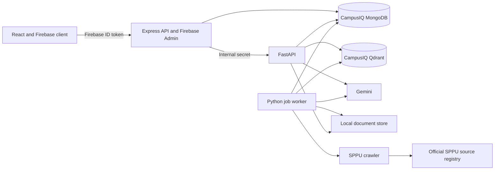

# Design and reference review

## Reference code

The files in this workspace are under `refereance/` rather than the `references/` paths in the brief. Both exports were inspected without editing their source.

- **CampusIQ Onboarding v0.6** contains the Requests and BeautifulSoup crawler, Playwright SharePoint group expansion, optional Gemini ranking of existing links, PDF download checks, pypdf and PyMuPDF extraction, Tesseract fallback, a SQLite page index and exact lookup CLI, and an HTML evidence report. CampusIQ adapts these patterns in `crawler/`. The worker records crawl evidence, metadata, warnings and exact page data in MongoDB and serves evidence reports through the admin portal. The original six regression tests can run directly against the reference.
- **EduMind AI** includes a compiled Firebase/React bundle, Firebase web config and rules, Python requirements, a Dockerfile, Render and Vite configuration, and a README describing FastAPI, Firebase verification, SQLite, Qdrant dense and BM25 retrieval, Gemini, chunking and reranking configuration. The React and Python application source referred to by those manifests is absent from this export. CampusIQ implements equivalent patterns and adopts the two models declared in EduMind's Dockerfile. The Firebase console determines which providers work for the shared project.

The crawler is a shared Python package. FastAPI and the worker live side by side under `ai-service/` and start as separate processes. This keeps slow OCR, browser expansion and embedding writes outside HTTP request lifetimes. The worker uses a MongoDB lease and durable queued jobs. Scheduled job state and manual observations survive service restarts.

## Data and publication lifecycle

- `users` stores the Firebase UID, backend role and CampusIQ academic profile.
- `sources`, `jobs` and `runtime` store the official source registry, scheduled and manual jobs, and the worker lease.
- `documents`, `versions` and `pages` store the active publication pointer, content hashes, reviewable versions, extracted pages and exact identifiers.
- `reviews` and `audit` record decisions, verification details and administrator activity.
- `chats` and `messages` store owner-scoped sessions, questions, rewrites, intent and citations.
- `notifications` stores publication events shown while the corresponding version is active.

The document store uses SHA-256 filenames. MongoDB keeps metadata, page text and identifiers. Qdrant vectors reference document and version IDs. A chat question creates a durable worker job. The worker checks saved evidence, asks Gemini to refine the search where needed, and performs a bounded crawl of configured official SPPU sections. Public documents with an official origin, issuer, readable native text and applicable academic scope can be saved automatically. SPPU's legacy timetable library is accepted only when linked directly from its secure official Examination homepage and the PDF stays within that library. Answers identify legacy HTTP links. Administrators inspect documents, users, exclusions and service status through read-only routes.

Publication builds the Qdrant index first, then changes the MongoDB active pointer with a compare-and-set against the expected prior version. A failed index operation leaves any previous publication active. Retrieval uses active MongoDB version IDs in Qdrant and MongoDB filters and rechecks cited versions after generation. The worker removes stale vectors and retries delayed cleanup. An old conversation's citations are checked on read.

Changes at the same URL share a document family. Matching revised titles at new URLs can suggest a predecessor. Exact source URLs and content hashes identify stored versions. Revised documents at different URLs retain their provenance. Future crawls of either URL are compared against that family's active version. Automatic indexing checks for conflicting known scope fields and earlier publication dates.

## Discovery and answer controls

- Approved SPPU hosts and the optional exact SharePoint tenant resolve to public addresses only. Every request pins the selected public IP while retaining the original hostname for Host and TLS verification. Redirects are checked at every hop. Chromium's GET subresources go through the same bounded client. The worker follows robots rules, limits bytes, depth, pages and calls, and uses link, table and group context to prioritize candidates.
- A category needs direct document evidence. Explicit programme, branch, academic year, study year, semester, session, pattern, exam type and identifiers are checked when recognized. Dates are compared with source metadata or page text. Publication and effective dates serve distinct sorts. “Latest” always includes a coverage caveat because crawl coverage is bounded.
- Retrieval fuses Qdrant cosine results with MongoDB text search and BM25 ranking. CampusIQ uses BAAI BGE-small for embedding and the MS MARCO MiniLM cross-encoder for reranking, matching EduMind's Dockerfile. Student profile signals are soft preferences when the question leaves the field open. Exact identifiers are matched in native indexed pages with token boundaries.
- Gemini receives authorized evidence as data and returns candidate excerpts and evidence IDs. CampusIQ verifies the excerpts against the passages and builds URLs and page references from trusted metadata. Invalid, unsupported or withdrawn evidence produces an explicit abstention. There is no generated numeric reconstruction from OCR.
- Restricted records are reviewed as private evidence. A student-visible card contains a reviewed title and applicable public metadata, with a link to the official listing and a reference to the inspected page. Raw restricted pages, PDF links and individual case matches are available only to authorized admin routes. Synthetic records are used in exact-match tests.

## Scope and operational limits

V1 covers the configured SPPU sections and the supported academic vocabulary. Unusual source redesigns, ambiguous abbreviations, missing publication dates, inconsistent OCR and documents lacking meaningful heading evidence can require manual review. The student chat stores history and treats each question as a fresh retrieval request. It does not infer missing academic scope from a prior answer.

The Windows configuration binds services to loopback. Protect MongoDB, Qdrant and the document store before exposing or deploying services. For production, require encrypted private service traffic, database authentication, least-privilege credentials, restricted file storage and an institutional retention policy for user queries, logs and restricted source records. Keep web access to the Firebase Authorized Domains you control.

## Reference crawler parity and search reporting

The crawler adapts v0.6's Requests and BeautifulSoup extraction, table-row context, URL deduplication, bounded pagination and Playwright SharePoint group expansion. At shallow depths Gemini ranks the discovered links and PDFs, with deterministic ranking when Gemini is unavailable. Robots redirects are validated on every hop. Source content remains untrusted.

The original prototype's CLI and report are preserved in the reference folder. CampusIQ integrates these techniques into durable chat jobs and stores evidence, links and per-page text in MongoDB. Replies identify the actual discovery method and list inspected sources when evidence does not answer the question.

## Conversation deletion

Deletion checks ownership, marks the conversation deleted, removes messages, cancels queued jobs and marks running jobs for cancellation. Workers check deletion before and after message writes. A tombstone prevents a late worker result from restoring the conversation. Shared document and vector records are independent of chat ownership.
